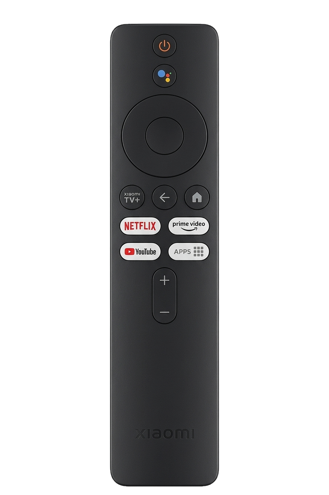

# Xiaomi TV Box S 2nd Gen (`XMRM-M3`) for Mac (Based on SayAll App)

[简体中文](README.md)

Forked and adapted from [SayAll (`HD838A/remote-mic-app`)](https://github.com/HD838A/remote-mic-app), turning the **Xiaomi TV Box S (2nd Gen) Bluetooth remote (Model: `XMRM-M3`, Bluetooth name: `Xiaomi RC`)** into a **Mac voice-input trigger and shortcut controller**.

<p align="center">
  
</p>

## Key Adaptations for `XMRM-M3`

- **Hardware Identification & Battery Reporting**
  - Recognizes VID `0x2717` / PID `0x32B9`, DIS model string `FH005`, and advertised Bluetooth name `Xiaomi RC`.
  - Handles the absence of Xiaomi ATVV GATT audio services (`AB5E0001`) on macOS cleanly, entering `.ready` state with battery reporting without reconnection loops.
- **15 Physical Keys + 16-Control Interactive Mapping Canvas**
  - Maps every physical button using its printed label: `Power`, `Up / Down / Left / Right`, `OK`, `Xiaomi TV+`, `Back`, `Home`, `NETFLIX`, `prime video`, `YouTube`, `APPS`, and `Volume+ / Volume-`.
  - Supports **single press, double press, and hold** actions (shortcuts, media/system controls, launching or focusing apps) on a dedicated `XMRM-M3` remote photo canvas.
- **System Key Neutralization**
  - Voice button (Consumer `0x00CF`): prevents macOS from triggering built-in Siri.
  - Power button (Consumer `0x0030`): remapped to `F20` to prevent accidental Mac sleep.
- **Mac Voice Input Integration (Built-in Mac Microphone)**
  - Pressing the `XMRM-M3` voice button drives your configured trigger key (`Fn/Globe`, Command, Option hold, or simulated `Fn` tap) to activate Mac voice input tools using your **Mac built-in microphone**.
- **Virtual Audio Driver-Free Onboarding**
  - Onboarding automatically detects `XMRM-M3` and allows completing setup and voice verification directly with your Mac's built-in microphone—no virtual loopback audio driver required.
- **Backward Compatible**
  - Preserves full original support for Xiaomi Bluetooth Remote 2 (`RC001`) and 2 Pro (`RC003`).

## Hardware Profile

| Property | Value |
| --- | --- |
| Device | Xiaomi TV Box S (2nd Gen) Remote |
| Model | `XMRM-M3` (DIS `Model Number`: `FH005`) |
| Bluetooth Name | `Xiaomi RC` |
| VID : PID | `0x2717 : 0x32B9` |
| HID Usage Page | Consumer Control (`0x0C`) |
| Voice Input Mode | Voice key trigger (`0x00CF`) + Mac built-in microphone |

## Build & Package from Source

```zsh
# 1. Run SelfTest and SwiftPM build
SDKROOT=/Library/Developer/CommandLineTools/SDKs/MacOSX26.5.sdk ./scripts/test.sh

# 2. Build public compatibility app bundle (output: dist/SayAll.app)
SDKROOT=/Library/Developer/CommandLineTools/SDKs/MacOSX26.5.sdk \
  SAYALL_PRIVATE_PLATFORM_MODE=public \
  SAYALL_BUILD_CHANNEL=public \
  CODE_SIGN_IDENTITY=- \
  ./scripts/build-app.sh
```

After building, copy `dist/SayAll.app` into `/Applications` and grant **Bluetooth**, **Input Monitoring**, and **Accessibility** permissions when prompted.

## License & Acknowledgments

- Based on [HD838A/remote-mic-app (SayAll)](https://github.com/HD838A/remote-mic-app) ([sayall.app](https://sayall.app/)).
- Licensed under **`GPL-3.0-only`**. Brand assets such as the App Logo and App Icon remain subject to [LOGO-LICENSE.md](LOGO-LICENSE.md). See [COPYRIGHT.md](COPYRIGHT.md) and [THIRD_PARTY_NOTICES.md](THIRD_PARTY_NOTICES.md) for full notices.
