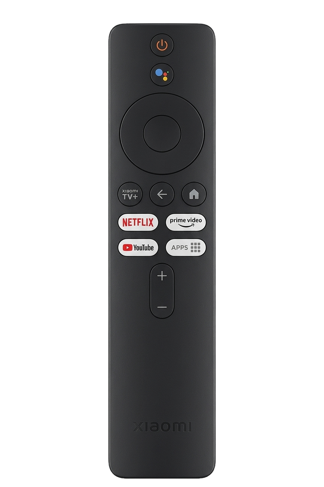

# Xiaomi TV Box S 2nd Gen (`XMRM-M3`) for Mac（基于 SayAll App）

[English](README.en.md)

基于开源项目 [无线麦 SayAll (`HD838A/remote-mic-app`)](https://github.com/HD838A/remote-mic-app) 深度适配，将 **小米盒子 2 代海外版蓝牙遥控器 `Xiaomi TV Box S (2nd Gen)`（型号：`XMRM-M3`，蓝牙名：`Xiaomi RC`）** 变成 **Mac 语音输入与快捷控制设备**。

<p align="center">
  
</p>

## 核心适配特性

- **硬件精准识别与稳定连接**
  - 支持 VID `0x2717` / PID `0x32B9`、DIS 型号 `FH005` 及广播名称 `Xiaomi RC`。
  - 针对 `XMRM-M3` 在 macOS 下不暴露小米 ATVV 蓝牙音频流服务（`AB5E0001`）的特性，优化连接状态机使其正常保持 `.ready` 并实时读取电池电量，不再因缺少语音服务而反复重连。
- **全部 15 颗印字按键独立自定义 + 专属可视化画布**
  - 按遥控器实际印字定义并映射全部 15 颗可编程按键：`电源`、`上 / 下 / 左 / 右`、`确认 (OK)`、`Xiaomi TV+`、`返回`、`主页`、`NETFLIX`、`prime video`、`YouTube`、`APPS`、`音量+ / 音量-`。
  - 每颗按键均支持**单击、双击、长按**，可绑定键盘快捷键、媒体/音量控制、打开或切换常用 App、发送常用操作或组合键，并在「按键映射」页面配备 `XMRM-M3` 真机图与 16 键连线高亮界面。
- **系统键冲突抑制（防误触 Siri 与休眠）**
  - 语音键（Consumer `0x00CF`）：阻止 macOS 唤出原生 Siri。
  - 电源键（Consumer `0x0030`）：重映射为无害的 `F20`，避免误按导致 Mac 休眠。
- **Mac 语音输入工具联动（配合 Mac 本机麦克风）**
  - 按下 `XMRM-M3` 语音键后，依据你在 App 中配置的语音键模式（`Fn`/地球键、Command、Option 长按，或模拟 `Fn` 点按），自动触发豆包输入法、macOS 听写等语音工具并直接使用 **Mac 本机麦克风** 收音识别。
- **免虚拟声卡的新手引导直通**
  - 首次设置向导自动识别 `XMRM-M3` 为 Mac 本机麦克风路径，无需安装 `SayAll` / `BlackHole 2ch` 等虚拟音频驱动即可直接完成全部引导与实测。
- **兼容原有型号**
  - 完整保留原版对小米蓝牙遥控器 2（`RC001`）、小米蓝牙遥控器 2 Pro（`RC003`）等设备的支持。

## 硬件参数参考

| 项目 | 参数 |
| --- | --- |
| 适用设备 | 小米盒子 2 代海外版遥控器（Xiaomi TV Box S 2nd Gen） |
| 遥控器型号 | `XMRM-M3`（DIS `Model Number`: `FH005`） |
| 蓝牙广播名 | `Xiaomi RC` |
| USB/HID VID : PID | `0x2717 : 0x32B9` |
| 按键协议 | HID Consumer Page (`0x0C`) |
| 语音链路方案 | 物理语音键触发（`0x00CF`） + Mac 本机麦克风 |

## 首次配对与使用步骤

1. 打开 Mac **系统设置 → 蓝牙**。
2. 按遥控器说明书长按配对组合键使 `XMRM-M3` 进入蓝牙配对模式，在 Mac 蓝牙列表中连接 **`Xiaomi RC`**。
3. 打开 **SayAll.app**，按新手引导在 **系统设置 → 隐私与安全性** 中为 SayAll 开启以下权限：
   - **蓝牙**：识别设备型号与读取电量
   - **输入监控**：捕获 `XMRM-M3` 全部实体按键与语音键
   - **辅助功能**：发送自定义快捷键与语音键触发信号
4. 在引导页选择你的 Mac 语音输入工具（如豆包输入法 / 系统听写，工具内麦克风选择 **Mac 本机麦克风**），无需虚拟音频设备即可完成语音与按键验证。
5. 进入主界面的 **「按键映射」** 页面，即可对照 `XMRM-M3` 真机图自由设置每颗按键的单击、双击与长按动作。

## 从源码本地构建与打包

在仅安装 Command Line Tools 或系统默认指向测试版 SDK 的 macOS 环境下，建议显式指定稳定版 `MacOSX26.5.sdk`（并保留 `--disable-keychain`）：

```zsh
# 1. 运行自测与 SwiftPM 编译检查
SDKROOT=/Library/Developer/CommandLineTools/SDKs/MacOSX26.5.sdk ./scripts/test.sh

# 2. 打包为可运行的本地 App（输出位于 dist/SayAll.app）
SDKROOT=/Library/Developer/CommandLineTools/SDKs/MacOSX26.5.sdk \
  SAYALL_PRIVATE_PLATFORM_MODE=public \
  SAYALL_BUILD_CHANNEL=public \
  CODE_SIGN_IDENTITY=- \
  ./scripts/build-app.sh
```

构建完成后，可将 `dist/SayAll.app` 拖入 `/Applications` 应用程序目录直接运行。

## 开源许可与致谢

- 本项目派生自开源项目 [HD838A/remote-mic-app（无线麦 SayAll）](https://github.com/HD838A/remote-mic-app)，原项目官网：[sayall.app](https://sayall.app/)。
- 本仓库代码沿用原项目的 **`GPL-3.0-only`** 开源协议；App Logo 与图标等品牌资产条款见 [LOGO-LICENSE.md](LOGO-LICENSE.md)，第三方声明与版权详情见 [COPYRIGHT.md](COPYRIGHT.md) 与 [THIRD_PARTY_NOTICES.md](THIRD_PARTY_NOTICES.md)。
